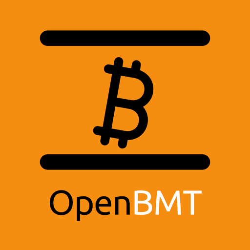

<p align="center">
  
</p>

# OpenBMT

[](https://github.com/AvilaLabs/OpenBMT/actions/workflows/ci.yml)
[](LICENSE)

**A bitcoin-first point of sale for independent shops, paid directly to the
shop's own wallet.**

**Pre-release. Do not use with real funds.** The Android apps are early builds
that run on an Android emulator and have not yet been tested on a phone.
OpenBMT has had internal design reviews; no independent security audit has
been completed.

## Get started

- [Read the handbook](https://openbmt.avilalabs.org/handbook/): what OpenBMT does,
  how the money is kept safe, and where that protection stops
- [See what OpenBMT is and what is built](#about-openbmt)
- [Explore documentation](#documentation)

## About OpenBMT

OpenBMT is becoming a complete point of sale for independent shops that take
bitcoin: the shop rings up the whole sale in OpenBMT and takes bitcoin, cash
and cards there, and the bitcoin goes straight to the shop's own wallet. It
runs on an Android phone or tablet at the counter and the owner's own Android
phone. Nothing has to be bought, and there is no OpenBMT server or account.
What the terminal must do is written down rule by rule in
[the terminal rules](docs/TERMINAL-RULES.md), and
[the terminal map](docs/terminal-map.md) shows where each of the 502
capabilities a shop register needs is covered.

Built so far: taking a bitcoin payment at the counter and keeping its record,
the owner phone's view of the shop's coins, refunds and moving savings, and
the shop's own Lightning node on the counter. Ringing up items, tax,
discounts, cash, cards, receipts, the drawer, staff and stock come next.

### The parts

| Part | What it does |
|---|---|
| [Counter app](apps/counter-android/) | Runs the sale, shows the payment code and says what it has checked about each payment. It holds no savings key. |
| [Owner app](apps/owner-android/) | The shop's coins, refunds, moving savings to the shop's own wallet, settings and the books. |
| [Box](crates/openbmt-box/) | Optional. A small always-on service the shop can run to pass messages between its devices. It holds no wallet key. |

The [Key app](apps/key-android/) belongs to an earlier 2-of-3 wallet setup
that is no longer the main path; it is due to be removed or rebuilt as a
single-key signer.

## Payments and records

- **On-chain:** a counter paired with the shop's own wallet makes each
  address from the wallet's public description, and never shows one twice. It checks payments over the
  Bitcoin network itself, with no outside server, and against the shop's own
  Bitcoin Core node when there is one. See
  [payment checks](docs/WATCHER-RULES.md) and
  [counter behavior](docs/COUNTER-RULES.md).
- **The shop's money:** a new shop can start on a small capped wallet on the
  owner phone ([start simple](docs/START-SIMPLE-RULES.md)) and move to its
  own wallet, a hardware wallet for most shops. See
  [wallets](docs/WALLET-RULES.md) and [spending](docs/SPEND-RULES.md).
- **Lightning:** the shop's own node runs on the counter
  ([Shop Lightning](docs/SHOP-LIGHTNING-RULES.md)). A provider opens the
  channel but never holds the shop's money.
- **Books:** sales records, summaries and exports. See
  [books and exports](docs/BOOKS-RULES.md).

## Current status

The Rust components and the Android apps build and their tests pass. The apps
are signed with a local test key and have been checked on an Android
emulator, not yet on a phone. Bitcoin Core regtest runs check specific flows,
including restore and payment; they do not show readiness for real funds.
See [the design](docs/DESIGN.md) and the [research notes](docs/research/).

The Box can be run from source:

```bash
git clone https://github.com/AvilaLabs/OpenBMT.git
cd OpenBMT
cargo run --locked -p openbmt-box -- \
  target/box-preview 127.0.0.1:8986 \
  --status-page 127.0.0.1:8987
```

Open [http://127.0.0.1:8987](http://127.0.0.1:8987) to see its status page;
type `quit` in the terminal to stop it.

## Documentation

- [Handbook](https://openbmt.avilalabs.org/handbook/) (source in [docs/handbook](docs/handbook/);
  build with `mdbook build`)
- [Terminal rules](docs/TERMINAL-RULES.md) · [Terminal map](docs/terminal-map.md)
- [Design and threat model](docs/DESIGN.md)
- [Payment checks](docs/WATCHER-RULES.md) · [Counter](docs/COUNTER-RULES.md) · [Owner app](docs/OWNER-APP-RULES.md)
- [Wallets](docs/WALLET-RULES.md) · [Spending](docs/SPEND-RULES.md) · [Signer](docs/SIGNER-RULES.md)
- [Shop Lightning](docs/SHOP-LIGHTNING-RULES.md) · [Books and exports](docs/BOOKS-RULES.md) · [Giving](docs/GIVING-RULES.md)
- [Screen catalogs](docs/screens/) · [Bitcoin Core engineering notes](docs/research/)

## Development

The Rust workspace uses a committed `Cargo.lock` and requires Rust 1.89 or
newer. Common checks are:

```bash
cargo fmt --all -- --check
cargo clippy --workspace --all-targets --locked -- -D warnings
cargo test --workspace --locked
```

See [dependency rules](docs/DEPENDENCIES.md) before changing dependencies.
Report vulnerabilities using [SECURITY.md](SECURITY.md).

## Licence

OpenBMT is licensed under the [MIT licence](LICENSE).
