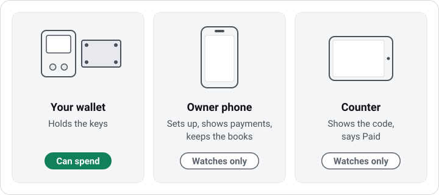
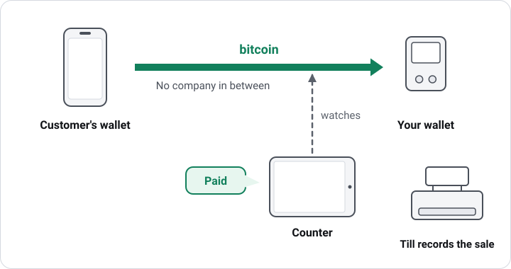
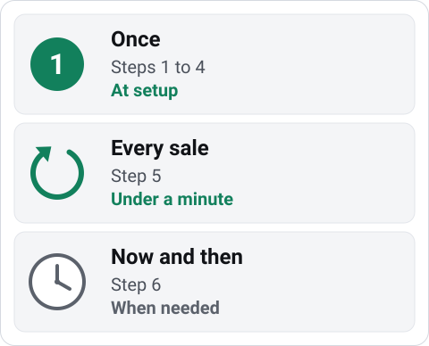
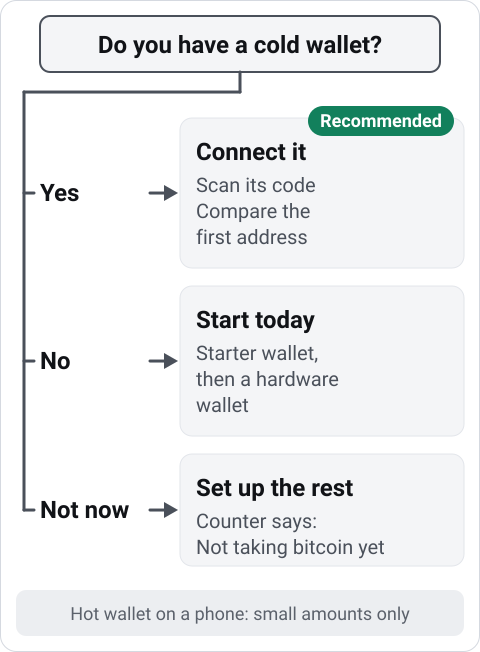
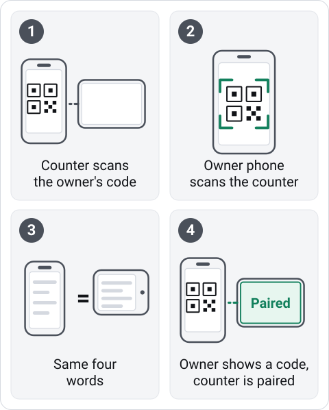
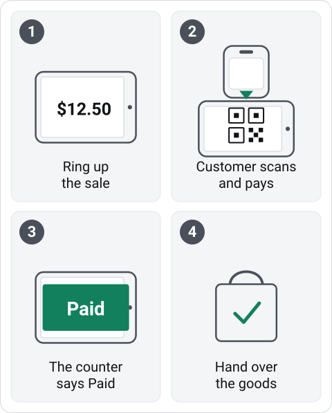
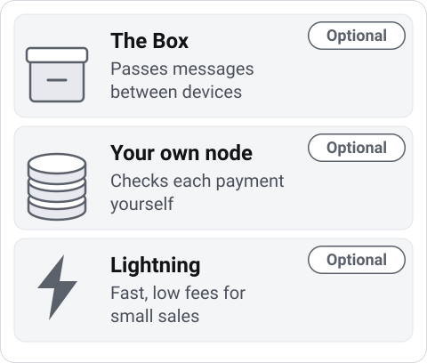
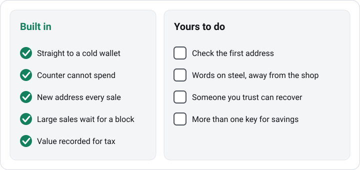

# Getting started, step by step

This page puts the whole setup in order: the three parts a shop needs,
what each one does, and when you use it. Each step says whether it is
built.

> **OpenBMT is pre-release. It has had internal review only and no
> independent security audit. Do not use it with real funds.**

## The three parts

| Part | What it is and does |
|---|---|
| **Your wallet** | A hardware wallet, with its recovery words written by hand and later kept on steel. It holds the keys: the shop's bitcoin lands here, and only it can send money out. Until it arrives, a starter wallet on the owner phone can hold a small amount you choose. |
| **Owner phone** | Your own Android phone with the OpenBMT Owner app. It sets up the shop, shows every payment, keeps the books, and prepares refunds and cash-outs for your wallet to sign. |
| **Counter** | An Android phone or tablet where you ring up sales, with the OpenBMT Counter app. It shows the customer a payment code for each sale and says when it is paid. It cannot spend your savings. |

The counter holds only your wallet's public description. It lets it make
a new address for each sale and see payments arrive. It cannot spend. A
lost or stolen counter does not put the money in your wallet at risk; it
can show the shop's payments, so lock it with a PIN.

## How a payment travels

The customer's wallet pays an address of your wallet. The counter watches
the Bitcoin network for that payment and tells the cashier when it has
arrived. The counter never holds the bitcoin, and no company sits between
the customer and your wallet.

## When you do what

| When | What and where |
|---|---|
| Once | Steps 1 to 4, on the owner phone, your wallet and the counter. |
| Every sale | Step 5, at the counter. |
| Now and then | Step 6, on the owner phone and your wallet. Minutes, when needed. |

## Step 1. Install the Owner app on your phone

**Where:** owner phone. **When:** once.

Install the Owner app and open it. The first screen offers to try it
first: a practice shop runs one sale from start to finish with pretend
money, then deletes itself. It needs no wallet and no second device.

**Status:** built for Android. The apps are not yet published for
download.

## Step 2. Name the shop

**Where:** owner phone. **When:** once.

Enter the shop's name and its money.

**Status:** built.

## Step 3. Choose your wallet

**Where:** owner phone, with your wallet. **When:** once.

A **cold wallet** keeps its keys on a device that never connects to the
internet. This is the industry's standard for money a business keeps. A
**hot wallet** is an app on a phone or an online computer; it is fine for
small amounts but not for a shop's takings.

- **I have a cold wallet.** The owner phone reads the wallet's public
  description from a code on the wallet's screen. You then compare the
  first receiving address on both screens; they must match before the shop
  takes a payment. A description that holds a private key or recovery
  words is refused.
- **Start today, then move to a hardware wallet.** The owner phone makes a
  starter wallet with a limit you choose: the most you would be OK losing
  if the phone were stolen. When your hardware wallet arrives, everything
  moves to it in one step. The owner phone says which hardware wallets
  work and how to buy one safely; it names no brand.
- **Not now.** Step 4 can be done first. The counter shows "Not taking
  bitcoin yet" until a wallet is added.

**Status:** built; tested against Bitcoin Core on a test network, not yet
run on a phone.

## Step 4. Set up the counter

**Where:** the counter and the owner phone. **When:** once per counter.

1. Install the Counter app on the phone or tablet you ring up sales on.
2. On the owner phone, choose Add a counter. It shows a code; scan it with
   the counter. The counter shows your wallet's first address: check it
   against your wallet.
3. The counter shows a code; scan it with the owner phone. Both screens
   show the same four words. Check that they match.
4. The owner phone shows a last code. Scan it with the counter, which then
   says Paired.

From then on the counter makes addresses only for your wallet. Keep it
plugged in and on the shop's Wi-Fi.

**Status:** built; not yet run on a phone.

## Step 5. Take a payment

**Where:** the counter. **When:** every sale.

1. Ring up the sale on the counter. Today that means typing the amount;
   items, tax, discounts, cash and cards on the same screen are the next
   work.
2. The customer scans the code with their wallet and pays.
3. The counter says Paid.
4. Hand over the goods.

Small sales can be handed over as soon as the payment is seen, within
limits you set. Larger ones wait for the payment to be in a block, which
takes about 10 minutes on average. [A sale at the counter](getting-paid.md)
explains each result the counter can show.

**Status:** taking a bitcoin payment is built; tried on an emulator, not
yet on a real phone. Ringing up items is not built yet.

## Step 6. Now and then

**Where:** owner phone and your wallet.

| Task | What you do |
|---|---|
| A refund in bitcoin | Prepare it on the owner phone, then sign it with your wallet. A refund in cash needs no wallet. |
| Cashing out | Send from your wallet to an exchange you choose, and sell there. Only then does a bank come back in. |
| Books | On the owner phone, open Books and save the accounting file for your bookkeeper. It records each sale's value in your money at the time of sale. |
| Backup check | Every few months, make sure the steel plate is where you left it and that the person you chose knows how to find it. |

**Status:** the books screen is built. Refunds and transfers signed from a
wallet you hold are built and tested against Bitcoin Core on a test
network, not yet run on a phone.

## Optional parts

| Part | What it adds, and when it is worth it |
|---|---|
| **The Box** | A small computer in the shop that passes messages between the shop's devices. Today Shop Lightning also keeps its second copy there; keeping that copy on another counter or the owner phone instead is being built, so that Lightning will need no Box. |
| **Your own Bitcoin node** | A second, independent check of each payment, on a computer you run. Worth it when you want to rely on nobody else's view of the network. |
| **Lightning** | Fast, low-fee payments for small sales, through the shop's own Lightning node on the counter. A channel provider opens the channel but never holds your money. Worth it when you sell many small items, such as coffee. |

## The good practice behind these steps

These are the habits that experienced merchants who keep their own
bitcoin follow. OpenBMT builds most of them in; the rest are yours.

| Habit | Who does it |
|---|---|
| Payments go straight to a cold wallet | Built in |
| The counter cannot spend | Built in |
| A new address for every sale | Built in |
| Large sales wait for a block | Built in; you set the limits |
| Each sale's value in your money is recorded for tax | Built in (Books) |
| The first address is checked on the wallet's own screen | You, once, at step 3 |
| The words are written by hand, then put on steel, and kept away from the shop | You |
| Someone you trust can recover the money if you cannot | You |
| Larger savings need more than one key to spend | You; [Who controls the money](safety.md) explains how |
