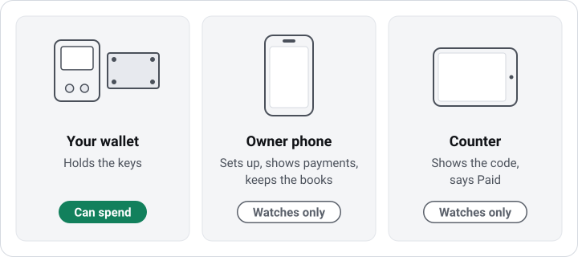
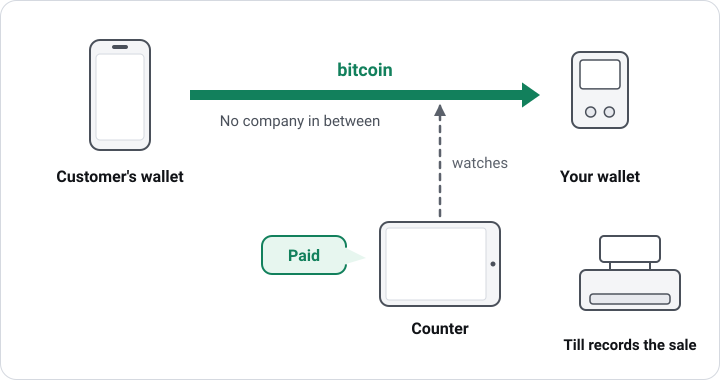
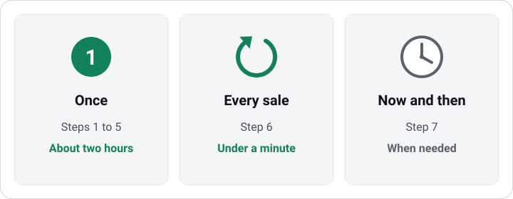
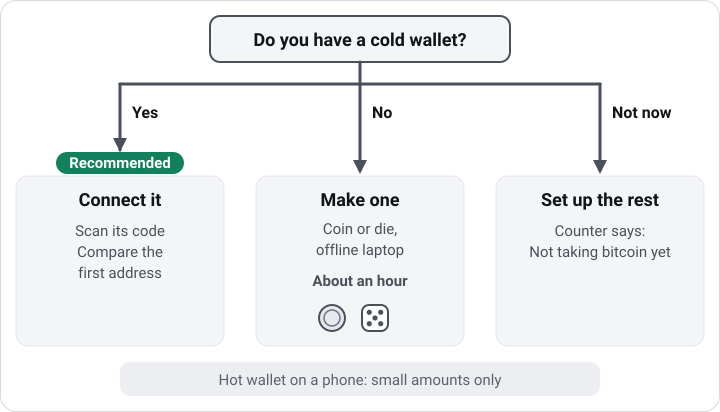
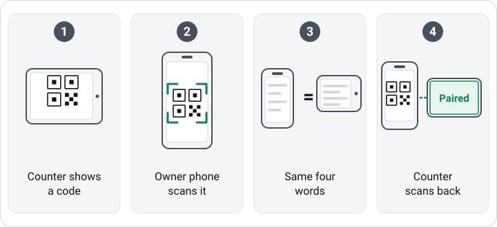
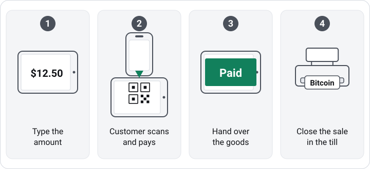
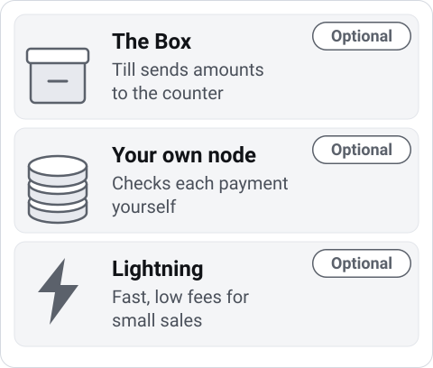
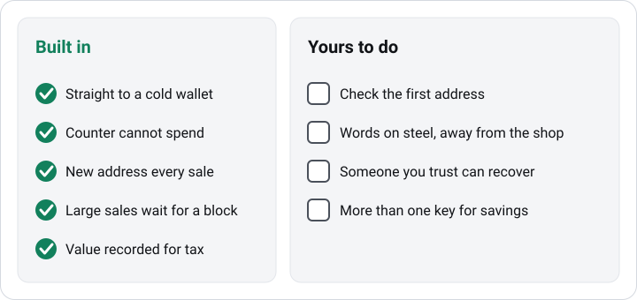

# Getting started, step by step

This page puts the whole setup in order: the three parts a shop needs,
what each one does, and when you use it. Each step says whether it is
built.

> **OpenBMT is pre-release. It has had internal review only and no
> independent security audit. Do not use it with real funds.**

## The three parts

| Part | What it is | Its job | Can it spend the money? |
|---|---|---|---|
| **Your wallet** | A hardware signer, such as a Coldcard or a Passport, or a computer kept offline, with 12 recovery words written down and put on steel | Holds the keys. Every payment lands here, and only this can send money out. | Yes. Nothing else can. |
| **Owner phone** | Your own Android phone with the OpenBMT Owner app | Sets up the shop, shows every payment, keeps the books, and prepares refunds and cash-outs for your wallet to sign | No |
| **Counter** | An Android phone or tablet at the till with the OpenBMT Counter app | Shows the customer a payment code for each sale and says when it is paid | No |

The owner phone and the counter hold only your wallet's public
description. It lets them make a new address for each sale and see
payments arrive. It cannot spend. A lost or stolen phone does not put the
money in your wallet at risk; it can show the shop's payments, so lock
both phones with a PIN.

## How a payment travels

The customer's wallet pays an address of your wallet. The counter watches
the Bitcoin network for that payment and tells the cashier when it has
arrived. The counter never holds the bitcoin, and no company sits between
the customer and your wallet. The till records the sale as it does any
other payment.

## When you do what

| When | What | Where | Time |
|---|---|---|---|
| Once | Steps 1 to 5 | Owner phone, a laptop, the counter, the till's back office | About two hours, most of it making the wallet |
| Every sale | Step 6 | Counter and till | Under a minute |
| Now and then | Step 7 | Owner phone and your wallet | Minutes, when needed |

## Step 1. Install the Owner app on your phone

**Where:** owner phone. **When:** once.

Install the Owner app and open it. The first screen offers to try it
first: a practice shop runs one sale from start to finish with pretend
money, then deletes itself. It needs no wallet and no second device.

**Status:** built. The apps are Android only and are not yet published for
download.

## Step 2. Name the shop and choose your till

**Where:** owner phone. **When:** once.

Enter the shop's name and its money, then pick the till you use today
from the list: Square, Toast, Shopify POS, Loyverse, Odoo, Hike, StoreHub,
"No till" or "Another till".

**Status:** built.

## Step 3. Choose your wallet

**Where:** owner phone, with your wallet or a laptop. **When:** once.

A **cold wallet** keeps its keys on a device that never connects to the
internet. This is the industry's standard for money a business keeps. A
**hot wallet** is an app on a phone or an online computer; it is fine for
small amounts but not for a shop's takings.

- **I have a cold wallet.** The owner phone reads the wallet's public
  description from a code on the wallet's screen. You then compare the
  first receiving address on both screens; they must match before the shop
  takes a payment. A description that holds a private key or recovery
  words is refused.
- **Help me make one.** You make the wallet yourself on a laptop you
  already own, offline, from about 512 coin flips or about 270 die rolls.
  It takes about an hour, with two USB sticks, a pen and the card from the
  app. [Setting up a shop](setting-up.md#making-a-savings-wallet-with-a-coin-or-a-die)
  has the steps.
- **Not now.** Steps 4 and 5 can be done first. The counter shows "Not
  taking bitcoin yet" until a wallet is added.

**Status:** making a wallet with a coin or a die is built and tested on a
computer kept offline. Connecting a wallet you already have is being
built.

## Step 4. Set up the counter

**Where:** the counter and the owner phone. **When:** once per counter.

1. Install the Counter app on the phone or tablet that stays at the till.
   It shows a code.
2. On the owner phone, choose to add a counter and scan that code.
3. Both screens show the same four words. Check that they match.
4. The owner phone shows a code. Scan it with the counter, which then says
   Paired.

From then on the counter makes addresses only for your wallet. Keep it
plugged in and on the shop's Wi-Fi.

**Status:** built for the earlier setup with a separate Key phone
([Who controls the money](safety.md)). Joining a counter to a wallet you
hold is being built.

## Step 5. Add Bitcoin to your till

**Where:** your till's back office. **When:** once.

In most tills this means adding a payment type called Bitcoin, which takes
about two minutes. The owner app shows the steps for your till. The till
company does not move this money, so it charges nothing for that payment
type.

**Status:** built. With Odoo and the optional Box, the till can also send
the amount to the counter, so the cashier does not type it twice.

## Step 6. Take a payment

**Where:** the counter and the till. **When:** every sale.

1. Ring up the sale in the till as usual.
2. Type the amount on the counter, or let the till send it.
3. The customer scans the code with their wallet and pays.
4. Hand over the goods when the counter says so.
5. In the till, close the sale with the Bitcoin payment type.

Small sales can be handed over as soon as the payment is seen, within
limits you set. Larger ones wait for the payment to be in a block, which
takes about 10 minutes on average. [A sale at the counter](getting-paid.md)
explains each result the counter can show.

**Status:** built; tried on an emulator, not yet on a real phone.

## Step 7. Now and then

**Where:** owner phone and your wallet.

| Task | What you do |
|---|---|
| A refund in bitcoin | Prepare it on the owner phone, then sign it with your wallet. A refund in cash needs no wallet. |
| Cashing out | Send from your wallet to an exchange you choose, and sell there. Only then does a bank come back in. |
| Books | On the owner phone, open Books and save the accounting file for your bookkeeper. It records each sale's value in your money at the time of sale. |
| Backup check | Every few months, make sure the steel plate is where you left it and that the person you chose knows how to find it. |

**Status:** the books screen is built. Refunds and transfers signed from a
wallet you hold are being built.

## Optional parts

| Part | What it adds | When it is worth it |
|---|---|---|
| **The Box** | A small computer in the shop that lets the till send amounts to the counter | When typing each amount twice slows the queue |
| **Your own Bitcoin node** | A second, independent check of each payment, on a computer you run | When you want to rely on nobody else's view of the network |
| **Lightning** | Instant, low-fee payments for small sales, through your own Lightning node or a swap service you name. The money still lands in your wallet. | When you sell many small items, such as coffee |

## The good practice behind these steps

These are the habits that experienced merchants who keep their own
bitcoin follow. OpenBMT builds most of them in; the rest are yours.

| Habit | Who does it |
|---|---|
| Payments go straight to a cold wallet | Built in |
| The counter cannot spend | Built in |
| A new address for every sale | Built in |
| Large sales wait for a block | Built in; you set the limits |
| Each sale's value in your money is recorded for tax | Built in (Books) |
| The first address is checked on the wallet's own screen | You, once, at step 3 |
| The words are written by hand, then put on steel, and kept away from the shop | You |
| Someone you trust can recover the money if you cannot | You |
| Larger savings need more than one key to spend | You; [Who controls the money](safety.md) explains how |
