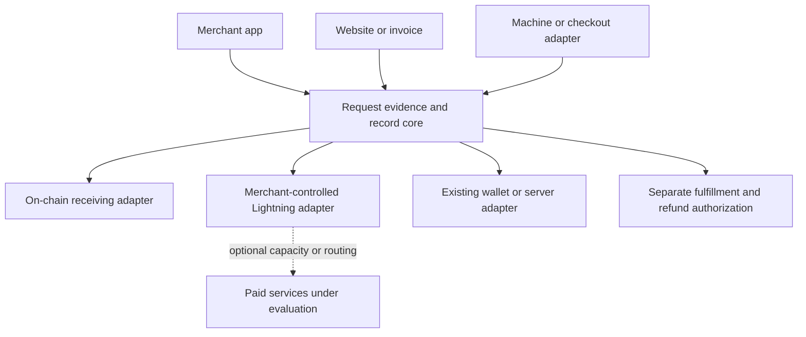
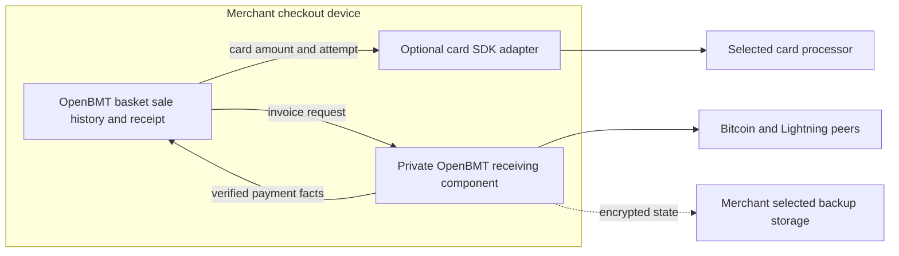

# Merchant Acceptance Architecture Investigation

Research snapshot dated 16 November 2026; milestone update recorded 16 November in America/New_York (17 November UTC). Evaluated source snapshot: `93a02c093f631251bb58169d0d064cdc560f1517`. Proposed behavior and scoped test evidence are distinguished throughout. The receiving implementation remains pre-release.

Prepared 16 November 2026. Scope: Bitcoin acceptance for fixed and mobile retail, online checkout, invoices, donations, recurring services, and unattended equipment. The no-custody requirement remains a hard constraint. Replaceable paid services are candidates for evaluation; their inclusion here does not establish that they satisfy the merchant’s independence requirements.

## Current adoption priority and limits

The current sequence is standalone OpenBMT POS first, followed by integration into existing POS systems. The standalone checkout accepts full Bitcoin on merchant-controlled keys, cash, and optional third-party card processing. It owns the canonical basket, sale, tender attempts, receipts, and reconciliation. This is a deliberate bounded product choice that asks participating merchants to use OpenBMT for order entry and closeout; it does not claim general-purpose POS parity. Existing POS preservation remains valuable deferred research for a later integration phase.

The first card-adapter implementation should use the tested Square Mobile Payments SDK Sandbox flow as its starting point. The Sandbox result proves only a virtual-card test path with restart recovery. It does not prove production eligibility, account/country support, physical-reader compatibility, privacy approval, or merchant suitability. Validate each additional adapter and intended deployment separately. Cash needs no processor, and Bitcoin acceptance must continue when card integration is unavailable.

The standalone delivery plan defines the finite scope, implementation slices, evidence, and release gates. Previously prioritized POS-preserving work is deferred; the historical investigation remains available for future adapter planning. Full Bitcoin means on-chain receiving to merchant-controlled keys plus the planned Shop Lightning route when its separate funding and recovery gates are met. No mainnet or real-funds readiness is claimed by the current evidence.

### Unresolved requirements

| Area | Question to resolve | Completion evidence |
| --- | --- | --- |
| Recovery without a Box | Can a merchant recover current channel state and funds after losing the sole checkout device, without a particular service’s permission? | Storage protocol analysis plus interrupted-write, stale-copy, total-device-loss and unavailable-provider tests. |
| Key isolation | Can proprietary card code coexist with a merchant-controlled receiver while preserving a meaningful security boundary? | Platform-specific process/identity design and a practical installation/background-operation experiment. |
| Mobile operation | What happens during sleep, suspension, reboot, battery loss and network transitions? | Native lifecycle and reconnection tests with actual receiver and SDK. |
| Receiving capacity | How are first receipt, liquidity replenishment, provider failure and fees handled? | Adversarial funding checks and workload/cost measurements under explicit trust assumptions. |
| Native card connection | Android MPS 2.7.0 Sandbox completed from the shared cart; the completed $10 card receipt survived force-stop and matched Square payment/attempt IDs. | Still needs pending-request uncertainty recovery, physical readers, supported account/device validation, and production/privacy review. |
| Business compatibility | Which existing catalog, tax, stock, printer, kitchen and reporting features carry over? | Explicit capability matrix and tests per provider/device; no generic compatibility promise. |
| Payment and order correctness | How do partial, excess, late, split, refunded and multi-device payments affect the order? | Verified evidence, durable state transitions, replay/crash tests and separate fulfillment records. |
| Universal coverage | Which parts apply to online checkout, invoices, subscriptions and machines? | Common payment contract with workflow-specific acceptance and acknowledgment tests. |
| Merchant economics | Does the design reduce total work and cost? | Setup/device/service counts, fee/capital estimates and observed merchant tasks. |
| Key provisioning | How many setup devices, backups and approvals does the merchant need? | Compare existing offline-root import and protected dedicated hot-key setup without silently changing key policy. |
| Payer interoperability | Which ordinary wallets and phone handoffs work with each request? | Versioned QR, NFC, link, expiry and same-device checkout tests; no required customer OpenBMT wallet. |

## Proposed product direction

OpenBMT’s strongest near-term direction is a merchant-controlled payment engine that can run inside a simple app, inside other software, or as a merchant-operated service. The merchant chooses the deployment once; the cashier or customer should not have to navigate that architecture during a sale. POS compatibility remains one distribution route alongside standalone acceptance, websites, invoices, and machines.

The product’s contribution would need to be measurable reductions in setup, receiving maintenance, failure recovery, and reconciliation. A common API is useful engineering, but it is not itself a novel merchant benefit. BTCPay already offers a browser POS with keypad and cart modes, payment buttons, invoice APIs, and subscription management. It is the main functional benchmark for reuse and comparison. [BTCPay apps](https://docs.btcpayserver.org/Apps/), [custom integrations](https://docs.btcpayserver.org/CustomIntegration/), [subscriptions](https://docs.btcpayserver.org/Subscriptions/)

A new settlement network should remain a research option rather than the product’s initial dependency. Current Bitcoin and Lightning request formats can support much of the acceptance surface without requiring every customer to install an OpenBMT wallet. The remaining gaps are operational and architectural as well as protocol-related. Subscription management can schedule renewals or consume prepaid credits; it does not imply permission to debit an arbitrary self-custodial customer wallet.

## Proposed software boundaries

This diagram shows software interfaces and authority boundaries, not the path of funds. Deployment remains a merchant choice; the native Lightning engine can hold hot channel keys.

## Merchant workflows

The same payment engine can expose different workflows while preserving payment evidence and merchant control. The following are proposed product behaviors, not claims about currently available OpenBMT integrations.

| Merchant situation | Proposed everyday experience | Minimum deployment and unresolved burden |
| --- | --- | --- |
| Mobile seller or simple counter | Enter the amount once or choose items; show one request; receive a clear result and receipt. | A supported phone/tablet running the receiver, or connected to a merchant-operated receiver; device support, on-chain observation, backup/recovery, and Lightning state/receiving capacity must be established explicitly. |
| Existing retail checkout | Checkout supplies amount and order reference; payment result returns before the sale completes. | A supported integration or another explicitly evaluated checkout arrangement. Native integration remains platform dependent. |
| Online store | Backend creates a request for the cart; the customer pays with their wallet; the store verifies status before fulfilling. | An always-available merchant-operated receiver or chosen service, durable order state, and authenticated event delivery. |
| Contractor or B2B invoice | Send a payment link or QR; track installments, due amount, late payments, and receipts. | A persistent invoice record and receiver. Fiat-denominated invoices need explicit exchange-rate and expiry terms. |
| Tips or donations | Display a reusable destination; payer chooses amount. | A reusable offer or endpoint can help. Address reuse, wallet compatibility, availability, and acknowledgment vary by method. |
| Kiosk or vending machine | Machine requests an exact amount, reserves the item, verifies payment, and records the dispense result. | Receiver plus a durable command/acknowledgment path to the machine. A payment event alone cannot prove that goods were dispensed. |
| Recurring service | Customer renews or explicitly authorizes bounded scheduled payments; merchant updates access. | Billing state plus payer-side consent. Prepaid merchant credit is distinct from a self-custodial automatic debit. |

On-chain observation, Lightning receipt, and permission to fulfill must remain separate concepts. BTCPay’s integration model already distinguishes Processing from Settled and ties its invoice identifier to the merchant’s order. A browser redirect is not payment evidence. [Ecommerce integration guide](https://docs.btcpayserver.org/Development/ecommerce-integration-guide/)

## Architecture alternatives

| Architecture | Principal advantage | Tradeoffs and readiness |
| --- | --- | --- |
| On-chain app with merchant wallet data | Receiving can work without reserve signing keys on the checkout device. | Confirmation time, fees, synchronization, and immediate-delivery risk. Useful baseline; fast retail suitability needs measurement. |
| App with a local native Lightning node | Fast receipt with merchant-held channel keys. | Hot exposure, state recovery, uptime, capacity, and monitoring. Native OpenBMT work already exists. |
| Client over merchant-operated BTCPay or node service | Reuses invoice and integration infrastructure across interfaces. | Server installation, updates, backups, reachability, and Lightning operations. Strong reuse comparison. |
| Component embedded in another app | Payment can stay in the merchant’s familiar workflow. | Integration, platform access, releases, and support. Does not bypass closed software. |
| Dedicated terminal or appliance | Predictable hardware and persistent receiver. | Purchase, replacement, power/network, fleet support, and physical security. Extra devices must be disclosed. |
| New unified checkout | One cart and payment lifecycle across the merchant’s payment methods. | Large product alternative with migration and catalog/inventory needs. Cards retain their own acquirer, separate from bitcoin custody. |
| New application protocol | Consistent request, evidence, and receipt contract. | Adoption and maintenance cost. Develop from working adapters and a demonstrated gap. |
| New settlement architecture | Could change capital, latency, or receiving requirements. | New trust, recovery, wallet adoption, and maturity obligations. Separate research track. |

These are alternatives to compare, not a commitment to ship eight products. Broad architectural coverage can coexist with staged implementation. A native OpenBMT checkout can own the merchant interface and use supported provider SDKs for selected services. Square’s Mobile Payments SDK embeds its card-payment flow in iOS and Android applications, and its Catalog API provides access to merchant items. OpenBMT would still need its own cart, order orchestration, Bitcoin path and reconciliation. The follow-up below evaluates a local sale ledger that keeps Bitcoin out of Square Orders and Payments while retaining optional card, catalog and inventory connections. Device compatibility, receiver recovery and third-party SDK isolation from Bitcoin keys remain validation gates. [Square Mobile Payments SDK](https://developer.squareup.com/docs/mobile-payments-sdk), [Catalog API](https://developer.squareup.com/docs/catalog-api/what-it-does)

## Native checkout with an OpenBMT-owned sale ledger

Follow-up investigation, 16 November 2026. This is the first product path: standalone OpenBMT POS, with later integration into existing POS systems after the scoped workflow and release gates pass. OpenBMT would supply the checkout interface and canonical sale records; a connected provider supplies selected capabilities. Supported native card SDKs make this possible without containing the provider’s POS application. Keeping catalog or stock connections does not reproduce that provider’s complete business software.

The primary adoption test is a complete standalone merchant shift using OpenBMT for order entry and closeout. Existing-POS integrations are a later adoption path; the prior investigation remains deferred research. A merchant may continue its current POS until the standalone workflow is demonstrated and choose whether to migrate. Each connection preserves only tested capabilities, with no blanket parity promise. No provider account is required for standalone Bitcoin acceptance. Preserve the app-first/serverless default and existing custody, receiver, recovery, and Box requirements; neither route removes any current gate.

Evaluate adoption through measured setup/import burden, single sale entry, checkout speed and steps against the current workflow, an explicit list of essential supported features, combined records/refunds/reconciliation, and recovery by ordinary staff. Run actual merchant tasks and compare outcomes; “one app” alone is not a success criterion.

### Fee and API boundary of the standalone candidate

The published 1% rule concerns using Square Orders API with non-Square payments. Separate Bitcoin settlement alone does not avoid it if OpenBMT subsequently records that Bitcoin sale in Square Orders. If the Bitcoin sale never creates a Square Order or Payment, that documented trigger is absent. This is an inference from the published API pricing, not an account-specific billing determination. No Bitcoin-specific exemption is needed for the proposed route. [Square pricing](https://developer.squareup.com/docs/payments-pricing#orders-api-fee-structure), [external payment recording](https://developer.squareup.com/docs/payments-api/take-payments/external-payments)

| Operation | OpenBMT responsibility | Square involvement |
| --- | --- | --- |
| Bitcoin-only sale | Cart, quote, invoice/address, verified receipt, sale history and receipt | No Square Order, Payment, external-payment record or authorization required by design. |
| Optional catalog connection | Cache items and retain the exact price, tax and discount snapshot used for each sale | Catalog reads; not a payment operation. |
| Optional stock connection after Bitcoin sale | Persist one stock-adjustment operation and retry safely | Inventory adjustment only; not an Orders or Payments call. |
| Card sale | Local order and distinct durable payment attempt | Embedded card SDK handles the card flow. Ordinary card-processing fees remain. |
| Bitcoin represented as a paid Square order | Additional synchronization choice | Published external-payment/Orders pricing becomes relevant; excluded from the baseline design. |

Square explicitly documents using Inventory API adjustments when an application does not use Orders API to track sales. Send timestamped IN_STOCK-to-SOLD deltas with durable idempotency keys. Do not fetch a count, subtract locally, and overwrite it as a physical count: concurrent or offline sales can make that wrong. The connector must identify which system already applied each stock movement and avoid a second debit. No separate Catalog or Inventory charge was found in the published pricing; that is not a contractual guarantee. [Inventory process](https://developer.squareup.com/docs/inventory-api/how-it-works), [idempotent inventory requests](https://developer.squareup.com/reference/square/inventory-api/batch-change-inventory)

For card acceptance, the SDK’s itemized orderID is optional; its referenceID can link a card payment to the OpenBMT sale, while paymentAttemptID identifies a particular attempt. Omission is not a promise that Square creates no order internally: Payments API documentation says it generates an order when none is supplied. That card-processing record does not require a corresponding Bitcoin record. [SDK payment parameters](https://developer.squareup.com/docs/mobile-payments-sdk/ios/take-payments), [automatic card-payment orders](https://developer.squareup.com/docs/payments-api/take-payments/card-payments)

### Merchant experience and responsibility

The proposed everyday flow is one checkout: build the basket in OpenBMT, choose Bitcoin or card, complete that payment, and receive the result and receipt in OpenBMT. Bitcoin is sent to the merchant-controlled receiver. The optional card SDK presents its card-capture interface within the app and returns its result. Cashiers should not have to enter the amount again or manually close a second sale. The Android Sandbox prototype now demonstrates this flow with a test cart and virtual card, plus a separate Core Regtest Bitcoin path. It remains a product target beyond those narrow test cases; the integration does not reproduce Square’s full POS application or business features.

OpenBMT becomes the place for combined sales history, tax/discount records, receipt lookup, refunds and reconciliation. Square can retain its card-processing records and optionally stock data, but Bitcoin sales will not become Square sales merely because stock was adjusted. Square-specific loyalty, kitchen routing, appointments, itemized sales reports and other order-based workflows need individual integrations or replacements. This is a substantial checkout product commitment, even when a merchant keeps the same card processor.

The common sale engine should also serve web checkout, invoices and machine interfaces. Square is one optional adapter, not the engine’s identity. Bitcoin setup and acceptance must remain usable without Square OAuth, an active Square account or an OpenBMT-hosted authoritative ledger. A failed card connection must be contained to the card feature; this still needs testing with the actual SDK and mobile lifecycle. Catalog and stock access can request their own scopes independently of the card SDK’s payment permissions. [OAuth permission map](https://developer.squareup.com/docs/oauth-api/square-permissions)

### Correctness requirements

Freeze the order total and its currency/tax/discount terms before payment. Persist a fresh attempt before invoking a payment adapter. Accept the sale only from verified tender evidence under that rail’s policy. A lost card response is an unresolved charge, not a decline: reconciliation must establish its state before charging again or offering another rail for that amount. Offline card acceptance needs its own visible risk state.

Cancellation cannot revoke a Bitcoin address or reverse Bitcoin already received. Keep watching canceled or expired attempts, and flag subsequent money as late or excess rather than silently reopening the order or reducing stock again. Refunds reference the original tender, retain an audit trail, enforce cumulative amount limits and distinguish a refund obligation from a completed refund. Inventory delivery is a durable outbox operation; a remote side effect cannot share a SQLite transaction, so retries require an unchanged idempotency key and payload.

### Security and deployment limits

The tested Android Square SDK integration shares the app process with the checkout. This milestone used watch-only Bitcoin pairing and held no spending key, so it does not validate coexistence of Square code with Bitcoin signing keys. A stronger same-device receiver design still needs a meaningful process/identity boundary, private storage and restricted API; the proposed iOS extension and Android companion service remain unprototyped. Isolating keys also would not prevent a compromised checkout from substituting the displayed destination. [Apple extension process](https://developer.apple.com/documentation/extensionfoundation/appextensionprocess), [Android service identities](https://developer.android.com/guide/topics/manifest/service-element)

Square’s SDK requires supported accounts, devices and production app registration, and its current rules limit it to attended terminals/kiosks. It cannot supply a universal card adapter for unattended vending. Peripheral support and the receiver’s recovery model are additional gates. The current OpenBMT implementation’s Box backup requirement remains unresolved by this checkout architecture; the investigation has not established a safe single-device replacement. [SDK requirements](https://developer.squareup.com/docs/mobile-payments-sdk), [Stand and peripheral limits](https://developer.squareup.com/docs/mobile-payments-sdk/ios/square-stand)

### Earlier local ledger model: executed evidence

A separate Python/SQLite model was created outside the product repository. The coordinator ran `python3 -m unittest -v`: all 10 tests passed. It does not call the OpenBMT counter or load Square’s SDK. Deterministic doubles supply trusted synthetic payment outcomes; an accepted tender in this model is not proof of a real payment.

| Scenario exercised | Observed result |
| --- | --- |
| Bitcoin with no card provider supplied | Synthetic receipt accepted locally; command trace contained only Bitcoin invoice creation. |
| Optional stock synchronization | Separate inventory command; effect-then-timeout followed by reopen/retry produced one effect in the idempotent mock and one local stock delta. |
| Lost card response | Attempt stayed ambiguous; another tender and local cancellation were blocked until an injected terminal result. |
| Reopen and callback replay | Accepted local state remained; the duplicate event did not generate a second stock debit. |
| Canceled or superseded Bitcoin attempt paid later | Late attempt flagged for attention/refund obligation; sale and stock were not silently applied again. |
| Refund retry and cap | Reusing the same refund ID recorded one obligation; cumulative over-refund was rejected. |
| Duplicate basket SKU | Quantities aggregated before the single local inventory movement. |

Independent review found important boundaries: the model has no payment dispatcher or provider reconciliation after a crash, and it discards the invoice creation result. Restart tests establish state preservation and callback handling, not recovery of an interrupted charge. Amount/currency validation, BTC conversion, partial/excess payment detection, authenticated evidence, settlement, mobile background operation and power-loss recovery are absent. Refund entries are obligations or command traces, not completed refunds. The remote inventory result depends on the mock’s idempotency and does not test Square’s API. No split tender is implemented.

The previously identified native integration gate has now been exercised on Android: the $10 cart was paid through MPS 2.7.0 Sandbox, and the Bitcoin path was exercised with actual Core Regtest payments, including a partial payment, force-stop recovery, and an unchanged paid receipt after restart. This is evidence for the prototype only. Next gates include recovery from termination while a card request is pending, physical card-reader and supported-account/device checks, merchant onboarding, and an independently evaluated receiver/recovery setup. The separate SQLite routing model remains synthetic evidence and should not be confused with these app-level payment runs.

[Research tools and execution evidence](../../tools/merchant-acceptance-investigation/README.md)

## Hosting other business software inside OpenBMT

Reverse integration is a distinct candidate: OpenBMT owns the workspace and hosts or orchestrates other business software. It could keep payment controls and business context together without requiring each vendor to install an OpenBMT component inside its own native checkout.

| Version | Feasibility and boundary |
| --- | --- |
| Hosted web apps or merchant mini apps | A plausible host architecture using top-level WebViews/browser views and an explicit cart/request/status bridge. Web content can be incorporated in an app; vendor sign-in, hardware access, API support, and distribution permission still need validation. |
| Cooperating native Android apps | Cross-app activity embedding exists, but the embedded app must allow embedding or trust the host’s signing certificate. It is not general permission to contain any installed app. |
| Android launcher or managed terminal | OpenBMT can own the device workspace and coordinate allowlisted apps. They remain separate apps; their cart and payment authority do not automatically become accessible. |
| Arbitrary native apps on ordinary iOS or iPadOS | No general supported container route is established. Apple’s mini-app rules permit specified web-based experiences under conditions, not arbitrary installed native apps. |
| Desktop or dedicated operating environment | More control over app/window orchestration is possible. This adds deployment, hardware, and security scope, and still needs a deliberate data/payment integration. |

Sources: [Apple WebView](https://developer.apple.com/documentation/webkit/wkwebview), [Android cross-app embedding](https://developer.android.com/develop/ui/views/layout/activity-embedding), [Android dedicated-device mode](https://developer.android.com/work/dpc/dedicated-devices/lock-task-mode), [Apple app and mini-app rules](https://developer.apple.com/app-store/review/guidelines/).

Top-level hosting differs from putting a site inside an iframe. A website’s framing restrictions are not a general ban on top-level WebView navigation. However, a WebView is not automatically a supported environment: Google, for example, restricts embedded-user-agent OAuth sign-in. Use supported authentication flows rather than assume loading the page reproduces a native POS. [Google OAuth policy](https://developers.google.com/identity/protocols/oauth2/policies)

A web-hosting prototype would use a real, permission-compatible business app inside OpenBMT, with an explicit transaction bridge. Compare this with a fully native OpenBMT checkout using provider SDKs; the web shell is one hosting route, not a requirement for the product. It should obtain the exact order total and revision, keep the order pending, present OpenBMT’s verified payment interface, and return the result to the same order. Cart changes, duplicate requests, late payments, and payment-result forgery belong in the test. DOM scraping can be evaluated as a fragile adapter; it is not the baseline correctness contract. Native bridges must isolate untrusted guest software and avoid exposing wallet spending authority. [Android WebView bridge security](https://developer.android.com/privacy-and-security/risks/insecure-webview-native-bridges)

Display containment, order-data access, and authority to complete an order are three capabilities to verify separately. The hosting idea earns priority as a workflow experiment; its breadth across third-party apps remains an interoperability question.

## Custody and service independence

For every design, trace who holds keys, who can redirect incoming money, who can prevent a new payment, who can prevent recovery, what state must survive, and who sees payment metadata. Receiving credentials, hot channel keys, reserve spending keys, and refund authority are different capabilities.

The proposed hard gates are: merchant control of funds; no required OpenBMT account or company-hosted authoritative ledger; a documented recovery/exit path independent of the service being evaluated; and explicit limits on any automation that can spend. The canonical checkout ledger can remain merchant-controlled. These are design criteria to verify, not claims that all candidates already satisfy them.

Replaceability has to work operationally. A provider menu is insufficient if changing providers requires a live incumbent, or if all available inbound capacity sits with the failed peer. Independent fund recovery and continued ability to accept new payments are separate tests. Lightning’s enforcement also depends on retained channel state, timely chain monitoring, and the ability to publish transactions. [Lightning on-chain handling](https://github.com/lightning/bolts/blob/master/05-onchain.md)

Paid liquidity can be a purchase of network capacity rather than custody. It still introduces capital cost, service availability, metadata exposure, and sometimes a fee-prepayment risk. LSPS1 explicitly describes channel purchase as non-atomic: the buyer pays before the promised channel is delivered. [LSPS1 trust model](https://github.com/lightning/blips/blob/master/blip-0051.md#trust-model)

## Receiving and settlement mechanisms

Confirmed on-chain receiving is the clearest baseline for independent wallet control. A receive-only application can derive/watch addresses while signing remains elsewhere. Compact-filter clients reduce data requirements but still need header/filter checks, block retrieval, and appropriate peer behavior; they are not equivalent to querying a trusted balance API. [BIP 157](https://github.com/bitcoin/bips/blob/master/bip-0157.mediawiki), [BIP 158](https://github.com/bitcoin/bips/blob/master/bip-0158.mediawiki)

An unconfirmed transaction remains replaceable or may never confirm. Bitcoin Core enables full replacement policy by default; non-replacement signaling is not a guarantee. Immediate goods handover is a merchant risk decision, separate from confirmation-based settlement. [Bitcoin Core replacement policy](https://github.com/bitcoin/bitcoin/blob/master/doc/policy/mempool-replacements.md)

Native Lightning over already-confirmed channel funding offers a different receipt path, with online keys, monitoring, and receiving capacity as its operational costs. Receiving shifts balance toward the merchant. Spending through the channel can create room again. A splice-out withdraws local funds and shrinks the channel; it does not replenish inbound room. An off-chain-to-on-chain swap can replenish room along its payment route, at routing, provider, and on-chain cost. Existing Autoloop software demonstrates budgeted automation; it does not prove that one provider or policy is right for OpenBMT. [Autoloop](https://docs.lightning.engineering/lightning-network-tools/loop/autoloop), [channel protocol](https://github.com/lightning/bolts/blob/master/02-peer-protocol.md)

Just-in-time channels reduce advance provisioning but put funding on the payment path. LSPS2 distinguishes a client that waits to validate funding from a client that releases the payment preimage first. In the latter model a malicious provider can fail to publish valid funding after learning the secret. That is distinct from ordinary zero-confirmation risk for a real funding transaction. [LSPS2 trust models](https://github.com/lightning/blips/blob/master/blip-0052.md#trust-models)

## Other settlement designs

| Design | Relevant benefit | Security or adoption barrier under this brief |
| --- | --- | --- |
| Spark | Removes ordinary per-user Lightning channel management. | Its own documentation describes an operator key-deletion honesty assumption. A unilateral exit does not remove historical-key collusion risk. It does not qualify as equivalent to confirmed native Lightning. |
| Ark out-of-round payments | Fast transfers with different liquidity economics. | The documented OOR path relies on sender/server non-collusion until refresh. Assess the specific path and implementation rather than treating all Ark receipts alike. |
| Cashu or a custodial balance | Convenient account or bearer-token interaction. | The mint/provider holds the underlying bitcoin. Excluded by the no-custody requirement, including as an optional receiving balance. |
| Channel factories | Could amortize on-chain channel establishment across participants. | Shared funding, coordination, exit, capital allocation, and wallet adoption remain. Worth protocol research; not established as an OpenBMT deployment. |

Sources: [Spark’s security model](https://www.spark.money/tools/layer-2-security-comparison), [Ark OOR trust model](https://ark-protocol.org/intro/oor/index.html), [Cashu custody description](https://docs.cashu.space/faq), [original channel-factory paper](https://pmc.ncbi.nlm.nih.gov/articles/PMC6124062/).

## Where technical innovation could help

**Automated confirmed receiving reserve.** Maintain receiving capacity ahead of sales, reserve capacity for outstanding requests, replenish before depletion, and enforce a merchant fee budget. Independent funded peers could reduce reliance on one provider. The experiment must include bursts, simultaneous requests, provider failure, route failure, fee spikes, and restart. Reject the design if it routinely blocks sales or needs unacceptable fees, capital, or manual intervention. This is an engineering hypothesis built on existing mechanisms, not a claim of a newly invented payment protocol.

**Funding-verified first receipt.** Modify a receiver so it validates the promised funding output before releasing the payment secret, and uses a merchant-selected confirmation policy. A provider that insists on secret-first operation may refuse or time out; that is a real availability tradeoff. Test invalid outpoints, absent funding, underfunding, replacement, stalled publication, and invoice expiry. The current LSPS2 specification supplies the trust distinction; a successful honest-provider test does not cover an adversarial provider.

**Capacity purchase within channel establishment.** Investigate dual-funded channel/lease negotiation so the capacity and fee arrangement are tied to funding, rather than a separate non-atomic prepayment. Core Lightning exposes requested lease amounts and expected terms, and its opening hook can contribute a PSBT. Exact fee atomicity, lease enforcement, implementation compatibility, and available counterparties still need validation. This targets a particular non-delivery risk, not a guarantee of useful routing service. [Core Lightning fundchannel](https://docs.corelightning.org/reference/fundchannel), [dual-funding hook](https://docs.corelightning.org/reference/hook-openchannel2)

**Bounded operation during internet outages as a niche experiment.** Two parties with a previously confirmed direct Lightning channel may be able to exchange payment updates over a local connection during a bounded loss of internet access. BOLT permits suitable alternative transport and specifies peer-to-peer commitment updates. This needs advance funding, enough channel balance, compatible wallet software, retained state, and timely chain monitoring afterward. It is a hypothesis for repeat-customer/event/outage situations, not first-time offline bearer cash. Test isolated local connectivity, interrupted commitment exchanges, stale height, and subsequent force-close/recovery. [Lightning messaging and transport](https://github.com/lightning/bolts/blob/master/01-messaging.md)

**Portable merchant requests and receipts.** Standardize order binding, attempts, evidence, late payments, and fulfillment acknowledgments across app, web, invoice, and machine interfaces. Use existing payment instructions for ordinary customer wallets. Enhanced receipts or identity features can remain optional until interoperability is demonstrated. This is a plausible application protocol contribution; its value must exceed the cost of another integration standard.

## Compatibility and an open interface

Use BIP 321 as a payment-instruction envelope and BOLT 11 invoices as a Lightning compatibility target. Offer BOLT 12 where the receiver and payer support it. A reusable offer still produces fresh invoice requests and needs a reachable receiving arrangement. Specification support alone does not establish customer-wallet coverage. BIP 321’s proof callback is a local return on the payer’s device and explicitly excludes HTTP/HTTPS; it is not a merchant webhook. [BIP 321](https://bips.dev/321/), [BOLT 11](https://github.com/lightning/bolts/blob/master/11-payment-encoding.md), [BOLT 12](https://github.com/lightning/bolts/blob/master/12-offer-encoding.md)

Reuse Greenfield as a reference and backend adapter before promising compatibility with its whole ecosystem. Existing plugins may depend on more endpoints, authentication behavior, event formats, and versions than a small subset implements. LNURL can expose reusable reachable invoice endpoints. NWC is wallet access rather than an order protocol; receiving permissions, hosting, and custody depend on the actual wallet service. [Greenfield integration](https://docs.btcpayserver.org/CustomIntegration/), [LNURL pay](https://github.com/lnurl/luds/blob/luds/06.md), [NIP 47](https://github.com/nostr-protocol/nips/blob/master/47.md)

The proposed core contract contains a merchant/order reference, unique payment attempts, amount and currency terms, quote expiry, payment instructions, typed payment evidence, and refund/fulfillment records. It must preserve observed, accepted-at-risk, confirmed, Lightning-settled, canceled, late, partial, and excess-payment distinctions. Authenticate events and process them idempotently. A signed status authenticates its issuer; the underlying evidence and authority still need verification.

## Current OpenBMT building blocks

The source examined is commit 93a02c093f631251bb58169d0d064cdc560f1517. Its counter core separates judgment from clock, networking, files, and UI, and accepts a caller-supplied Store. That is a useful seam for app, server, and embedded hosting. It does not prove that finished adapters for those environments exist. [Core storage interface](https://github.com/AvilaLabs/OpenBMT/blob/93a02c093f631251bb58169d0d064cdc560f1517/crates/openbmt-counter/src/store.rs)

OpenBMT already implements native LDK integration, provider-backed liquidity acquisition, sweep behavior, and replicated channel state. Current first-build rules require a paired Box for the second copy and offline derivation/import of the Lightning seed. The source blocks mainnet operation. These are real implementation and recovery choices to evaluate; removing a required backup without replacing its safety properties would be a security change. [Shop Lightning rules](https://github.com/AvilaLabs/OpenBMT/blob/93a02c093f631251bb58169d0d064cdc560f1517/docs/SHOP-LIGHTNING-RULES.md)

The funding-publication probe below confirms a specific trust boundary in the current receiver: the payer can complete and the node can record PaymentClaimed while the promised funding transaction is absent, including with the bundled provider’s default setting under deliberate publication failure. Later funding-loss reporting cannot undo preimage release. Balance-sweep targets and cashier handover limits address different exposures; the test does not establish a false-paid cashier screen. [Claim implementation](https://github.com/AvilaLabs/OpenBMT/blob/93a02c093f631251bb58169d0d064cdc560f1517/crates/openbmt-lightning-node/src/node.rs)

The current native feature also controls whether the node uses real filesystem persistence or its in-memory browser store. A smaller deployment needs deliberately selected durable storage, rather than assuming that disabling networking only removes a payment rail. [Storage selection](https://github.com/AvilaLabs/OpenBMT/blob/93a02c093f631251bb58169d0d064cdc560f1517/crates/openbmt-counter-node/src/vfs.rs)

## Experiments completed

The initial API and native receiving experiments used OpenBMT source at commit 93a02c093f631251bb58169d0d064cdc560f1517. Product source files were not changed. Additional ledger and storage checks are documented separately with their exact scope.

**Real-core synthetic API probe.** A separate Rust package called the public counter library without Android or a Box process. Deterministic transaction sightings and health/heartbeat facts were injected; these were synthetic observations, not real settlement. The in-person sale moved from Waiting to PaidInstant after its configured wait. Repeating the same sightings did not add records. A sale’s external till identifier survived same-process snapshot reload. A remote-order judgment remained Waiting and emitted no PosPaid report. A canceled sale receiving a later synthetic payment stayed Cancelled with its late-payment flag set. This establishes API hostability and these state distinctions; it does not demonstrate a web integration or disk recovery.

The remote-order flag is supplied by the host on judgment. A universal service must retain and apply the correct context through restarts rather than trust a caller-selected fulfillment policy. The existing till association is not itself a complete ecommerce order contract.

**Native Bitcoin Core receiving drill.** The native counter_regtest example was built from the locked source with native/default features and exercised against Bitcoin Core 32.1 on an isolated local regtest chain. All 12 script checks passed: address derivation/receipt, waiting before confirmation, confirmed/final states, reorg reversal, retained disk state and no repeated reports after restart, abrupt termination just after confirmation, wallet ownership, and the own-node status/policy wiring.

The drill uses fixed test keys and a one-local-peer health override; it does not validate the real multi-peer health rules. Its own-node portion supplies observations to the counter from the test script, so it validates wiring rather than the production own-node connection. No real funds, mobile OS lifecycle, customer-wallet scans, real POS, provider liquidity, or unattended device fulfillment were tested. [Existing drill and its declared boundaries](https://github.com/AvilaLabs/OpenBMT/blob/93a02c093f631251bb58169d0d064cdc560f1517/scripts/counter-e2e-core.sh)

The feature-selection control confirmed that disabling the native networking feature selects browser-style in-memory storage; disk-recovery results above come from the native build. [Research tools and execution evidence](../../tools/merchant-acceptance-investigation/README.md): harness, locked dependencies, commands, metadata, and native drill log.

## Further investigation

One native checkout remains a credible product direction. A practical first target is an attended merchant using OpenBMT in the foreground, with a durable local sale ledger and an independently evaluated Bitcoin receiver. A single physical device, one application install, one visible checkout, continuous availability and independent recovery are separate requirements; each needs its own evidence.

### Recovery without an extra appliance

The current SecondDevice interface can be implemented by an off-device storage service rather than another merchant-owned computer. That is an architectural seam, not a finished cloud-backup feature. A phone could encrypt channel state locally and replicate it to merchant-selected storage, keeping spending keys on the phone. Such storage still affects availability, retention, metadata and recovery. No particular storage provider has been accepted as a product dependency.

Authentication proves that a blob was created by the key holder; it does not prove that it is the newest blob. After total device loss, a fresh install may also have lost its remembered version number. Multiple replicas need a specified commit, writer-ownership and recovery protocol with explicit failure assumptions. Several stores under one account are correlated; a generic two-of-three rule or choosing the highest returned number is not a proof against rollback.

LDK VSS is worth evaluating, but is not a verified replacement for the Box. The examined LDK-node adapter performs unconditional writes without a store-wide version check; an open upstream issue discusses recovery and concurrent-writer limitations. Its builder also labels VSS experimental and warns about unrecoverable persistence failures. OpenBMT currently uses direct LDK rather than that adapter. Any adoption needs a pinned implementation review and adversarial restore tests. [Adapter source](https://raw.githubusercontent.com/lightningdevkit/ldk-node/main/src/io/vss_store.rs), [upstream issue](https://github.com/lightningdevkit/ldk-node/issues/1090), [VSS builder](https://docs.rs/ldk-node/latest/src/ldk_node/builder.rs.html)

Seed recovery, channel-state recovery and sale-history recovery must be specified independently. A seed can recreate keys; current channel balances and pending contracts are evolving state. LND static channel backups instead ask peers to force-close and do not resume working channels; that is not a drop-in LDK recovery mechanism. A watchtower serves selected on-chain response needs and does not replace a complete state backup or an online receiver. [LND recovery limits](https://github.com/lightningnetwork/lnd/blob/master/docs/safety.md), [LDK state architecture](https://github.com/lightningdevkit/rust-lightning/blob/main/ARCH.md)

### Key separation on the same device

| Candidate | Merchant experience | Security boundary and remaining test |
| --- | --- | --- |
| Embedded card SDK and node in one process | One install and one checkout | Documented SDK route; no OS boundary between the library and node memory. Software trust remains explicit. |
| iOS or iPadOS 26 host plus private OpenBMT extension | Potentially one install and one checkout | Apple provides separate processes and XPC. Keep node secrets in extension-private storage and Keychain groups. Networking, lifetime, provisioning and interruption behavior require an actual device prototype. |
| Android host plus OpenBMT companion service package | One checkout; additional setup/install | Distinct UID and private storage can separate the node from the card SDK. Use a narrow authenticated bound-service interface; test lifecycle and coordinated updates. |
| OpenBMT with provider-app card handoff | One physical device; app transition for card sales | Existing supported handoff and separate app identities. Adds install/login and transition costs; a fallback candidate to measure. |
| Merchant-operated receiver elsewhere | One checkout interface; separate receiver deployment | Can keep signing away from card code. Count the server/device, maintenance and availability costs explicitly. |

Apple’s AppExtensionProcess is available on iOS/iPadOS 26 and creates a separate process with XPC communication. Its existence does not establish that a Lightning node can run indefinitely or that every card SDK supports every arrangement. Key provisioning must also occur within the protected component; importing a seed through the host would expose it there. Avoid shared secret containers and unrestricted signing APIs. A compromised checkout can still substitute the displayed destination even with isolated keys. [Apple extension process](https://developer.apple.com/documentation/extensionfoundation/appextensionprocess), [extension model](https://developer.apple.com/documentation/extensionfoundation/adding-support-for-app-extensions-to-your-app), [Keychain access groups](https://developer.apple.com/documentation/security/sharing-access-to-keychain-items-among-a-collection-of-apps), [Android bound services](https://developer.android.com/develop/background-work/services/bound-services)

### Mobile availability

A foreground checkout is a different operating case from an unattended, always-reachable payment endpoint. iOS may suspend background work, and background notifications do not guarantee timely delivery or execution. Background file transfer cannot keep a Lightning peer running. Android provides foreground-service mechanisms, but service types, battery restrictions, Doze, force stop and reboot/unlock affect behavior. The six-hour Android limit applies to specified service types such as dataSync; it is not a universal limit on every foreground service. The appropriate service category remains an implementation and distribution question. [Apple background notifications](https://developer.apple.com/documentation/usernotifications/pushing-background-updates-to-your-app), [Android service types](https://developer.android.com/develop/background-work/services/fgs/service-types), [Doze](https://developer.android.com/training/monitoring-device-state/doze-standby)

On reopening, the app should recover durable state, reconcile pending attempts, catch up required chain observations and establish readiness before offering new Lightning requests. Test screen lock, backgrounding, process termination, reboot before unlock, network changes and backup-store outages during an active payment. Websites, recurring invoice endpoints and unattended machines need a receiving deployment with the availability those workflows require. A merchant-operated always-on receiver remains an optional deployment; it is not silently supplied by a sleeping phone.

### Liquidity and the first receipt

The current `PaymentClaimable` gate requires every receiving channel to be known, expose its expected funding output, and meet the shop's configured confirmation depth (minimum one), or it fails the HTLC back without releasing the preimage. This is distinct from the cashier's goods-fulfillment policy. The updated Core Regtest probe has now confirmed three outcomes: deliberately withheld funding was rejected with no genuine preimage and no paid event; published-but-unconfirmed funding was also rejected with no genuine preimage; after the exact funding output was mined, retrying the same invoice succeeded once. The retry remains possible because the invoice expectation is removed only after `PaymentClaimed`. The node-claim gate passed 205 node tests, four key tests, Clippy and TCP all-target checks; Bitcoin Core reported 107 PASS with ALL PASS, and compact filters reported 37 PASS with ALL PASS. [Captured funding-gate evidence](../../tools/merchant-acceptance-investigation/evidence/funding-claim-gate-2026-11-16.json), [current claim gate](../../crates/openbmt-lightning-node/src/node.rs), [LSPS2 trust models](https://github.com/lightning/blips/blob/master/blip-0052.md#trust-models)

Confirmed receiving capacity acquired before checkout is the clearest conventional Lightning path to evaluate for reduced dependence on an unconfirmed first channel. It introduces setup time and fees. Buying capacity through LSPS1 needs a way to pay the provider and is non-atomic; an empty receiver cannot assume that existing earnings already fund this purchase. The current code has capacity-order automation, but its bundled ldk-node test provider explicitly refuses LSPS1 service. The documented LSPS1 end-to-end branch therefore cannot establish success with that provider version. [LSPS1 trust model](https://github.com/lightning/blips/blob/master/blip-0051.md#trust-model), [test provider limitation](https://github.com/AvilaLabs/OpenBMT/blob/93a02c093f631251bb58169d0d064cdc560f1517/tools/shop-lightning-lsp/src/main.rs)

Set receiving headroom from expected receipts during replenishment lead time, a burst allowance and outstanding invoice reservations; then test actual routing success. Track channel/service fees, miner fees, swap or rebalance costs, merchant capital and provider capital separately. Splicing money out reduces channel size; it does not restore inbound capacity. Provider diversity needs working independent peers, usable confirmed capacity and tested migration, beyond a provider selector. No market fee estimates or sustained workload results have been established.

### Historical funding publication checks before the claim gate

The executions in this section predate the strict gate and are retained as
historical evidence about the prior implementation. They are superseded for
current behavior by the gate results above.

Actual OpenBMT Shop Lightning, LND, the bundled liquidity-provider tool and Bitcoin Core were run on private localhost regtest chains. A proxy changed only the provider’s broadcast outcome: it decoded the funding transaction, returned nominal RPC success, and withheld that exact transaction and its retries. The merchant and payer used Core directly; Core had no external peer connections. This models a failed or dishonest publication path, not behavior attributed to a real provider.

| Provider setting | Normal publication control | Deliberately withheld publication |
| --- | --- | --- |
| client_trusts_lsp true in a temporary provider copy | Payer succeeded, preimage verified, funding visible in Core’s mempool and transaction lookup; still unconfirmed. | Payer succeeded and receiver recorded its claim, while the matching funding transaction was absent from both Core queries. |
| Bundled default client_trusts_lsp false, unchanged source | Same successful normal control with funding visible but unconfirmed. | Same claim-before-publication result with the matching funding transaction absent. |
| Portable repository probe, bundled default | Existing control above establishes the configuration. | Two fresh runs reproduced the withheld-publication result after packaging and safety checks. |

All six executions verified the payer’s preimage hash against its invoice hash. Each withheld case required a live regtest Core, the receiver’s exact matching funding txid, and explicit RPC error -5 from both getmempoolentry and getrawtransaction. The fixture’s 50,000-sat invoice yielded a 49,000-sat receiver claim after its 1,000-sat opening fee; those are test parameters, not market pricing.

The receiver’s paid event in these historical runs is a node-level `PaymentClaimed` record. It is not a demonstrated cashier paid screen or goods-fulfillment decision. The old result confirms that waiting longer to release goods did not protect an already-released preimage. The current gate results above now demonstrate refusal before publication/confirmation and success after the exact funding output is confirmed. No mainnet, physical mobile device, real Box hardware or actual merchant funds were involved in these historical runs.

The reproducible scripts and captured execution summary accompany this investigation. The publication check is a narrow receiver result and does not replace the project’s persistence, purity or signet gates.

### Native integration and business coverage

Square’s embedded SDK is a candidate for attended retail and mobile sales. Its unattended-use prohibition means another authorized adapter is needed for vending or an unattended terminal. Stand/Kiosk card support does not provide control of their attached printers, drawers or scanners. Catalog metadata can supply variations, modifiers, taxes and discounts, but OpenBMT must reproduce the supported calculation behavior and freeze the resulting sale snapshot. Optional itemized Square orders for card sales are a separate connector choice; Bitcoin remains outside Square Orders and Payments. [Square SDK limits](https://developer.squareup.com/docs/mobile-payments-sdk), [Stand peripherals](https://developer.squareup.com/docs/mobile-payments-sdk/ios/square-stand), [Catalog capabilities](https://developer.squareup.com/docs/catalog-api/what-it-does)

Stripe Terminal provides another native SDK and simulated-reader comparison, with its own reader, backend-token and payment-object requirements. It demonstrates why provider capabilities belong behind adapters rather than defining OpenBMT’s sale model. Provider authorization revocation should disable the affected connector while preserving local history and the independent Bitcoin path. The Square Android Sandbox flow now has an actual SDK test; other provider adapters and production isolation behavior still need their own tests. [Stripe setup](https://docs.stripe.com/terminal/payments/setup-integration?terminal-sdk-platform=android), [Stripe testing](https://docs.stripe.com/terminal/references/testing), [Square token revocation](https://developer.squareup.com/docs/oauth-api/receive-and-manage-tokens)

An Android Square Sandbox payment has now been completed from the OpenBMT cart using MPS 2.7.0 and the virtual reader; Square’s read-only Payments API confirmed the payment and matching attempt reference. A force-stop/relaunch preserved the identical native ledger and the itemized paid receipt. This does not validate production signature registration, supported device/country/account status, physical hardware, iPad, offline card acceptance, or merchant distribution. Offline card acceptance has separate seller opt-in, risk and reconciliation requirements and cannot be validated in Square Sandbox. [Square Android setup](https://developer.squareup.com/docs/mobile-payments-sdk/android), [offline testing limits](https://developer.squareup.com/docs/mobile-payments-sdk/android/offline-payments)

### The common checkout contract

The current POS matcher is a reconciliation layer for the existing separate checkout workflow. Its signed Bitcoin records, tender model, quote snapshots and persist-before-external-call patterns are useful building blocks; they do not already supply the new unified commerce ledger. The web-order flow is also separate. [POS contract](https://github.com/AvilaLabs/OpenBMT/blob/93a02c093f631251bb58169d0d064cdc560f1517/docs/POS-RULES.md), [web-order contract](https://github.com/AvilaLabs/OpenBMT/blob/93a02c093f631251bb58169d0d064cdc560f1517/docs/WEB-ORDER-RULES.md)

The common ledger should retain immutable basket/amount/currency and quote terms; durable payment attempts and external references; append-only received amounts and evidence; explicit unknown, partial, excess, late and refund states; and distinct fulfillment eligibility and acknowledgment. Crash recovery must query the existing external attempt before another charge. Duplicate or out-of-order webhooks are observations to reconcile, not authority to fulfill twice. Inventory reservations and multi-device stock conflicts need their own transactions and idempotency. [Square webhook delivery behavior](https://developer.squareup.com/docs/webhooks/overview)

### Convenience benchmark

Phoenix provides a useful phone-resident Lightning benchmark: its app contains a node, while its documented channel recovery retrieves encrypted state from its peer. That illustrates the difference between local signing and service-independent recovery. Its on-chain recovery path has delays and operational steps. BTCPay remains the broader merchant-functionality benchmark. Measure and reuse their demonstrated capabilities before introducing another payment protocol. [Phoenix build](https://github.com/ACINQ/phoenix/blob/master/BUILD.md), [Phoenix recovery discussion](https://github.com/ACINQ/phoenix/discussions/379), [ACINQ recovery procedures](https://github.com/ACINQ/lightning-kmp/blob/master/RECOVERY.md), [BTCPay deployment](https://docs.btcpayserver.org/Deployment/deployment/)

| Merchant measure | What to record |
| --- | --- |
| First usable payment | Active setup minutes, wall time, prerequisites and every device/service. |
| Ordinary checkout | Amount entries, app transitions, cashier interventions, customer help and completion latency. |
| Receiving readiness | Route failures, capacity depletion, background/reconnect time and blocked sales. |
| Economics | Setup and recurring cost, fees per amount received, locked capital and hot exposure. |
| Recovery | Device-loss result, provider-outage result, time to restore acceptance, and separate time until funds are spendable. |
| Compatibility | Ordinary payer wallets, providers, peripherals and workflow-specific completion behavior. |
| Ongoing work | Updates, backup failures, liquidity intervention, report discrepancies and support minutes. |

No convenience score or recovery-time guarantee is justified yet. A reasonable pilot compares the same merchant tasks and verifies zero false-paid or duplicate-fulfillment outcomes. A fresh-device restore and a delayed on-chain exit must be measured separately; a short universal recovery deadline would hide confirmation and channel timelock constraints.

### Service independence and the current privacy rules

The project’s current standard is stricter than merely holding the merchant’s keys: it rejects a trusted server that can hold, move, freeze or redirect funds or receive wallet descriptions and addresses. Metadata-only optional services must be separately chosen, labeled and disclosed. Replaceable services remain research candidates rather than accepted defaults. This report does not relax those rules or treat a noncustodial marketing label as sufficient. [Project standard and contact disclosure](https://github.com/AvilaLabs/OpenBMT/blob/93a02c093f631251bb58169d0d064cdc560f1517/docs/DESIGN.md)

| Component | Distinct question for acceptance |
| --- | --- |
| Liquidity peer | Can it block new receipt, withhold funding or prevent exit? Test confirmed-state recovery and alternate peers separately. |
| Encrypted state store | Can it withhold or replay the only recoverable state after device loss? Key encryption alone does not remove that dependency. |
| Card processor or SDK | Which card/device data does it receive, and can its code access the Bitcoin component? Bitcoin must remain independent of its authorization. |
| Price source | Can stale or manipulated rates change the invoice? Freeze terms and define the quote source and failure policy. |
| Web payment host | Can it substitute a destination? A server-rendered page does not inherit the trusted terminal’s address authority. |

### Onboarding and key provisioning

Current Shop Lightning setup uses an owner phone for authorization, offline BIP85 key derivation on a stick or capable signer, a counter to import the child key, and the Box. An offline stick also needs its host computer. A single daily checkout screen therefore does not describe the full setup burden. The project keeps the reserve master seed off phones and counters; changing that policy requires an explicit design decision. [Current key provisioning](https://github.com/AvilaLabs/OpenBMT/blob/93a02c093f631251bb58169d0d064cdc560f1517/docs/SHOP-LIGHTNING-RULES.md)

| Setup candidate | Benefit | Required accounting |
| --- | --- | --- |
| Existing reserve wallet with offline BIP85 import | Reuses the existing wallet backup and preserves the offline master policy. | Count signer/computer, owner authorization, child-key import and live channel-state backup. |
| Dedicated hot receiving seed created inside the protected component | Could simplify installation and avoid handling the reserve master seed in the checkout app. | New seed backup, secure provisioning and live channel-state recovery still required; not implemented. |
| On-chain first with Lightning enabled when ready | Can establish a simpler receiving baseline before capacity and node setup. | Confirmation policy and later migration/setup remain visible; current starter-wallet rules do not directly enable Shop Lightning. |

### Payer interoperability

Use ordinary Bitcoin and Lightning payment instructions rather than requiring a customer OpenBMT wallet. BIP 321 can carry an on-chain destination and a BOLT 11 invoice, but a standards-compliant request does not establish installed-wallet support or which payment method a wallet selects. Validate amounts, units, expiry and request refresh across both paths. BOLT 12 adds an invoice-request interaction and should remain an optional capability until tested with selected wallet versions. [BIP 321](https://github.com/bitcoin/bips/blob/master/bip-0321.mediawiki), [BOLT 11](https://github.com/lightning/bolts/blob/master/11-payment-encoding.md), [BOLT 12](https://github.com/lightning/bolts/blob/master/12-offer-encoding.md)

The current NFC implementation exposes a bitcoin URI through an Android emulated NDEF tag. The project already states that iPhone customers use the visible QR code: Apple background tag reading supports specified schemes and universal links, not arbitrary custom schemes. A server-controlled HTTPS payment-link tag would reintroduce destination-substitution authority that the current project policy explicitly rejects; it is not an approved workaround. NFC remains an enhancement until real customer-phone tests establish behavior. [Project tap limits](https://github.com/AvilaLabs/OpenBMT/blob/93a02c093f631251bb58169d0d064cdc560f1517/docs/TAP-RULES.md), [Apple tag dispatch](https://developer.apple.com/documentation/corenfc/adding-support-for-background-tag-reading), [project privacy policy](https://github.com/AvilaLabs/OpenBMT/blob/93a02c093f631251bb58169d0d064cdc560f1517/docs/DESIGN.md)

Test plain on-chain QR; combined request selection; standalone and URI-embedded BOLT 11; expired and refreshed invoices; partial-payment/requote updates; Android tag dispatch with and without a registered wallet; iPhone QR and link alternatives; and same-device web checkout with wallet absent, canceled return or no callback. A customer cannot scan a QR shown on the same phone without another mechanism, so web checkout needs copy and supported wallet links. A wallet return is navigation, not merchant payment evidence. Record actual wallet, OS and device versions; no broad compatibility rate has been measured.

### Candidate layout for one checkout device

This diagram is a proposed component layout, not a tested mobile deployment or a path-of-funds diagram. The private receiver boundary and the remote recovery protocol both remain to be proven.

### Storage checks executed

An isolated Rust package called the public storage, sealing and state-comparison APIs from OpenBMT commit 93a02c093f631251bb58169d0d064cdc560f1517. All four tests passed. The backend and payloads were synthetic; these were not live ChannelMonitor/ChainMonitor or payment-claim recovery tests.

| Check | Observed behavior |
| --- | --- |
| Strict write while the backup backend is unavailable | Completion remained pending and the old local value remained. Re-enabling the backend allowed both copies to expose the new value. |
| Ciphertext integrity and replay | Modification and a changed storage name failed authentication. An earlier valid blob under the same name still opened. |
| Update-number comparison | Newer maps selected repair, a forced older choice or divergence was refused, and identical old maps returned Same/Go. These were synthetic update maps, not monitor snapshots. |
| Backend falsely acknowledges durability | The write completed locally, but the later remote read found nothing. The fake backend violated its interface contract; this does not establish a Box defect. |

These checks establish narrow behavior and assumptions. Write cancellation, app suspension, actual process/crash restore, background manager ordering, fresh-device recovery, remote rollback attacks against full monitor state and on-chain fund recovery remain untested. OpenBMT already pins LDK 0.2.8, which includes important persistence-related fixes; its pinned async persistence API still carries a beta warning. The project’s stated real-funds gate requires the specified persistence review or removal of that beta status, the purist review and a signet run. No library upgrade or real-funds approval follows from these tests. [Pinned LDK release](https://github.com/lightningdevkit/rust-lightning/releases/tag/v0.2.8), [project gate](https://github.com/AvilaLabs/OpenBMT/blob/93a02c093f631251bb58169d0d064cdc560f1517/docs/SHOP-LIGHTNING-RULES.md)

[Research tools and execution evidence](../../tools/merchant-acceptance-investigation/README.md)

## Evaluation gates

| Gate | Evidence required |
| --- | --- |
| Merchant control | Trace every key and capability; demonstrate recovery with the service/provider unavailable. |
| First usable payment | Observe installation, wallet setup, funding/receiving readiness, and a completed first sale. Count every device and service. |
| Everyday work | Measure merchant interventions, update/backup work, liquidity incidents, and reconciliation over sustained use. |
| Customer compatibility | Test ordinary customer wallets and camera flows, with no mandatory special customer app; measure completion and help requests. |
| Payment reliability | Exercise partial, late, duplicate, expired, conflicting, and concurrent payments; distinguish received funds from fulfillment permission. |
| Failure recovery | Interrupt power, process, connectivity, provider, and storage at meaningful boundaries; reconcile afterward. |
| Unattended correctness | Couple durable payment/order state to item reservation and a durable machine acknowledgment; test interruption on both sides. |
| Economics | Count setup, hardware, hosting, network/routing/liquidity fees, tied-up capital, hot exposure, and support effort. |

No numeric score or winner is justified until these inputs are measured. A smooth scan in a controlled demo does not establish merchant convenience.

## Proposed implementation sequence

Deliver standalone POS in finite vertical slices, following [the standalone POS delivery plan](standalone-pos-delivery-plan-2026-11-16.md). Begin with canonical sale and tender state, then complete Bitcoin/cash/card sale flows, durable receipts and recovery, inventory and refunds, staff/owner permissions, cash management, peripherals, and day reporting. Run measured merchant shifts on actual target devices before release claims. Existing POS integration follows after these standalone gates; do not treat API-created orders or the old POS-preserving investigation as the current primary route.

The Square MPS Sandbox card path is the existing tested starting point, with no production or country eligibility inferred. Cash has no processor dependency. Bitcoin remains usable independent of card authorization/provider state. Preserve the accepted hot/cold wallet choices, owner authorization, and recovery requirements. Parallel foundation work is advisory or a proposal unless integrated and validated: UTXO fee/cost thresholds are not automated spending; confirmed-receiving assessment does not promise a route; backup fault fixtures do not establish Box recovery; guarded Books CSV is reconciliation output, not full accounting; the local events contract remains proposal-level. Cash-ledger/UI implementation in progress is not counted complete until validated; initial cash accounting is USD-only, with noncash drawer, shift, and refunds deferred until built.

Compare a merchant-operated BTCPay backend as a later implementation alternative if it can meet the standalone product requirements with lower burden. Keep capacity management, Lightning funding, isolation and recovery as explicit gates. Expansion to existing POS adapters, websites, unattended devices, or multiple locations requires separate evidence; each deployment earns its readiness claim. No mainnet or real-funds readiness is implied.

## Lightning and on-chain funds follow-up

The [merchant money system investigation](merchant-money-system-2026-11-16.md) examines one controller for receiving capacity, online exposure, fees, and output economics. It includes synthetic economic replays and Bitcoin Core regtest evidence for combining unilateral swap claims, plus a limited offline authorization for a future savings increase. These experiments validate narrow mechanisms; application integration, service independence, recovery, and sustained merchant economics remain release gates.

The [merchant product plan](merchant-product-plan-2026-11-16.md) records the accepted wallet authority choices. The [feature benchmark](merchant-feature-benchmark-2026-11-16.md) compares documented merchant capabilities, current OpenBMT components, recommended priorities, and custody/privacy exclusions.
